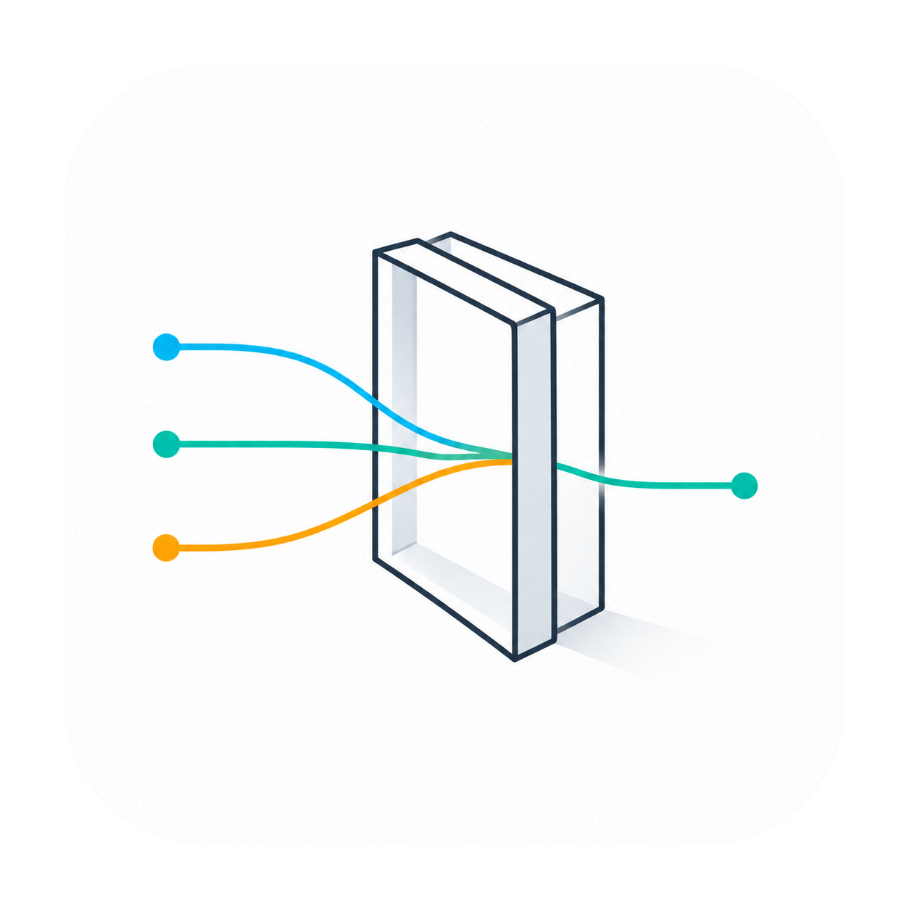

# Nexus-Gateway

  
  <h2>轻量的数据访问网关，统一接入异构数据源</h2>
  
面向应用的统一数据接入、连接管理与查询入口

  
<a href="README_zh.md">完整中文介绍</a> · <a href="README_en.md">English</a>

  

    
    
  

Nexus-Gateway 面向 AI、RAG、BI 和业务应用，是一个轻量的数据访问与连接管理入口。它把应用反复处理的驱动接入、连接配置、查询调用和结果分页收敛到统一 API，降低应用连接异构数据的集成成本。

## 我们的生态位

Nexus-Gateway 位于应用与数据系统之间：**它负责应用侧统一接入、数据源连接生命周期和网关控制；跨源查询能力可通过查询引擎适配扩展；原始数据仍由各自的数据系统管理。**

- **轻量接入模式：**单源访问可由网关驱动直接完成，不需要额外部署跨源查询引擎。运行服务仍需要按配置准备元数据数据库。
- **按需扩展跨源查询：**需要跨数据源关联查询时，可通过查询引擎适配层扩展联邦能力；查询时仍会产生网络传输和中间结果交换。
- **明确的产品边界：**Nexus-Gateway 聚焦应用侧统一入口、数据源连接管理和访问控制，不是数据库、数仓、ETL 或数据复制平台，也不重新实现分布式 SQL 引擎。

产品主打轻量、低资源占用和快速部署；当前仓库没有公开的资源或性能基准，因此不承诺具体的内存、CPU 或启动时间数字。

## 当前能力与集成状态

当前仓库包含数据源管理、驱动注册、连接诊断、配置校验、JWT 与限流组件，以及查询结果分批获取；兼容的驱动可使用流式游标。具体驱动能力以服务端类型接口和实现为准。

**跨源查询引擎适配尚未交付：**当前服务请求链路尚未接入联邦查询执行适配器，也没有跨源引擎连接配置的自动管理能力。因此，当前版本可以通过已接入的驱动访问单个数据源，但还不能经 Nexus-Gateway 执行跨源联邦 SQL。图中的虚线表示目标集成边界，不代表已交付能力。

~~~mermaid
flowchart LR
    App[AI / RAG / BI / 业务应用] --> Gateway[Nexus-Gateway 应用侧 API 与数据源管理]
    Gateway --> Drivers[当前：驱动与单源访问]
    Drivers --> Sources[数据库 / 数仓 / 湖仓 / 对象存储 / 文件]
    Gateway -. 目标集成：联邦查询适配器 .-> Engine[跨源查询引擎]
    Engine -.-> Catalogs[Catalogs 与连接器]
    Catalogs -.-> Sources
~~~

## 数据源范围

代码库中定义的代表性类型包括 MySQL、PostgreSQL、Oracle、SQL Server、OceanBase、TiDB、达梦、KingbaseES、ClickHouse、Doris、StarRocks、Snowflake、BigQuery、Iceberg、Delta Lake、Hudi，以及 S3、MinIO、OSS、COS、Azure Blob、HDFS、Ozone 和常见文件格式。类型是否在当前构建中启用、认证方式及高级能力因驱动而异，可通过服务端数据源类型接口和对应实现确认。

## 快速开始

需要 Go 1.25.1 或更高版本，以及按配置准备的元数据数据库。先检查 [配置说明](docs/configuration.md) 中的端口、数据库和安全选项，再获取代码：

~~~bash
git clone https://github.com/LuckyCaptain-go/Nexus-Gateway.git
cd Nexus-Gateway
go mod download
go run ./cmd/server
~~~

健康检查路径为 /health。当前配置文件中的凭据是示例值；启动代码仍使用固定的凭据加密主密钥，生产部署前必须替换并迁移到安全的外部密钥管理方式。

更多信息参见 [API 使用指南](docs/api_usage.md)、[架构设计](docs/architecture.md)、[配置指南](docs/configuration.md)、[开发指南](docs/development.md) 和 [中文完整说明](README_zh.md)。

如果这个项目对你有帮助，欢迎点亮 GitHub Star，也欢迎通过 Issue、Pull Request 参与开源共建。

## 跨源查询引擎扩展

后续将面向多种跨源查询引擎提供统一、无缝的接入能力，例如 Trino、Presto、OpenLooKeng 等。上述引擎是后续适配方向，当前仓库尚未交付相应的联邦查询适配器。

本项目采用 Apache License 2.0，详见 [LICENSE](LICENSE)。